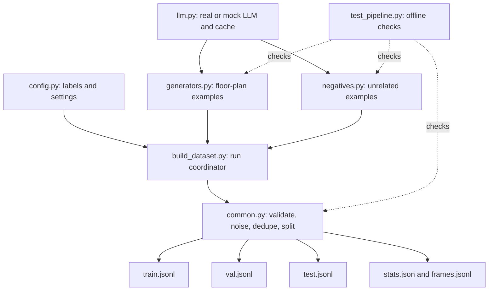

# Project Guide: Bedroom Count Classifier Data Pipeline

## 1. What the project does

This program creates sentences and gives each sentence a class number. A later classifier can learn to read a prompt and predict how many bedrooms it asks for. This repository creates the data; it does not train or serve the classifier. The classifier is intended to run without an LLM.

The labels are:

| ID | Label | Meaning |
|---:|---|---|
| 0 | 0 bedroom | A floor-plan request that asks for no bedrooms |
| 1 | 1 bedroom | It asks for one bedroom |
| 2 | 2 bedrooms | It asks for two bedrooms |
| 3 | 3 bedrooms | It asks for three bedrooms |
| 4 | 4 bedrooms | It asks for four bedrooms |
| 5 | 5 bedrooms | Five or more bedrooms with the default overflow rule |
| 6 | not related to floor planning or architecture in general | It is clearly about another subject |

## 2. Architecture



In simple words: configuration sets the rules; generators make candidate text; validation checks the labels; then the program balances, splits, and writes the rows. The tests check the important rules without network access.

## 3. File guide

| File | What it does |
|---|---|
| `config.py` | The central settings: label names, bedroom definitions, sentence frames, target class balance, overflow policy, noise, and LLM model IDs. |
| `common.py` | Converts a count to a class; checks spans and labels; applies noise; removes duplicate text; keeps groups together during splitting. |
| `generators.py` | Builds room lists and floor-plan requests. It includes hand-written templates, LLM-written frames, and checked LLM rewrites. |
| `negatives.py` | Creates unrelated prompts and prompts about bedrooms that are not floor-plan requests. It can also read a local text or JSONL file. |
| `llm.py` | Makes OpenRouter/NVIDIA NIM calls, provides the offline fake LLM, and stores raw answers in an append-only cache. |
| `build_dataset.py` | Command-line entry point. It runs generation, validation, balancing, splitting, and writing. |
| `test_pipeline.py` | Offline checks for parsing, labels, noise, negatives, and group splitting. |
| `requirements.txt` | Libraries needed by the generator. |
| `README.md` | Short setup and command guide. |
| `PROJECT_DOCUMENTATION.md` | This full guide. |
| `.gitignore` | Excludes virtual environments, Python bytecode, and generated output folders from normal Git status. |

Output folders such as `out_t`, `out_m`, and `out` contain generated data, not source code. Relative output folder names are placed beside the Python files, even if the command was launched from another current folder.

## 4. How labels work

### Floor-plan examples

The program knows the bedroom count while constructing each sentence. It keeps the bedroom phrase offsets in `spans` and the sum in `bedrooms`. The label is derived from that sum, never trusted from an LLM.

`OVERFLOW_POLICY = "fold"` is the default. It maps 6 or more bedrooms into class 5, so class 5 means “five or more.” With `OVERFLOW_POLICY = "drop"`, rows with more than five bedrooms are discarded. Some six-bedroom examples are generated under the default fold policy so that behavior is exercised.

`label_name` is just the human-readable version of `label`. Fine-tuning should use only `text` and `label`. `spans` and `bedrooms` are retained as an answer key for debugging and data checks.

### Negative examples

Clearly unrelated prompts use label 6. They have `spans: []` and `bedrooms: null`. Some mention a bedroom, mattress, sleep, or rent. These are intentionally negative because mentioning a bedroom does not mean a person is requesting a floor plan.

The built-in examples avoid uncertain cases such as interior decoration, property listings, and architecture questions that do not clearly request a floor plan. Keep those examples out until the user chooses their intended label.

## 5. Where text comes from

Positive rows come from three sources. Their default proportions are in `RATIOS`:

1. **template**: a hand-written request frame is filled with a generated room list.
2. **llm_frame**: an LLM writes a sentence frame with `{ROOMS}`. The program inserts the rooms, so the LLM never sees the answer while writing the frame.
3. **llm_full**: an LLM rewrites a full example where bedroom phrases are inside `[[double brackets]]`. The program recovers the spans and rejects unsafe rewrites.

The quantity parser and validator check that each bedroom span contains bedroom language, that no additional bedroom mentions are outside spans for positive rows, and that the span quantities add up to `bedrooms`. After the row receives a class, its label must match the configured overflow rule.

Class 0 has extra variety: studio apartments, offices, shops, halls, utility spaces, and “no bedrooms” examples, all worded as floor-plan requests.

Negative rows have two main sources:

- `neg_general`: food, coding, travel, weather, shopping, and other everyday prompts.
- `neg_bedroom_mention`: sleep, mattress, bedroom cleaning, rent, hotel, and bedroom colour prompts.

`--offtopic-file` reads a local source. Plain text files use one prompt per line. JSONL may contain `text`, `instruction`, or `prompt`. Groups of nearby file lines stay together during splitting. Half of the generated general negatives can come from the file; built-in fallback examples are mixed in. Obvious floor-plan and architecture terms are rejected from that external source.

`--negative-llm` optionally asks the configured LLM pool for cached negative examples. It is off by default. Basic filters run, but a person should review these examples before relying on them.

## 6. What happens in a run

1. Read command-line options and settings.
2. Calculate target rows for each of the seven classes from `TARGET_CLASS_DISTRIBUTION`.
3. Generate extra candidate rows using `OVERSAMPLE_FACTOR`.
4. Make positive examples and negative examples.
5. Validate labels and metadata. Rejected rows are counted by source, model, and reason.
6. Add optional typo and casing noise. Quantity words and digits inside positive bedroom phrases are not changed, and spans are recalculated. Noise on negative rows is safe because they have no spans.
7. Validate again and remove normalized duplicate text.
8. Select rows per class to approach the target distribution.
9. Split groups into train, validation, and test. A group never crosses splits. The splitter greedily balances labels and sources, but whole groups can make the exact proportions uneven.
10. Write JSONL data and `stats.json`.

LLM output is never trusted to set the label. Noise happens after LLM generation so the LLM cannot silently correct it. Cache entries are appended to JSONL files so an interrupted generation can reuse previous responses.

## 7. Row and output format

Example floor-plan row:

```json
{"text":"Design a house layout with 2 kitchens and one master bedroom.","spans":[[37,55]],"bedrooms":1,"label":1,"label_name":"1 bedroom","source":"template","llm":"","group":"tpl_1"}
```

Example negative row:

```json
{"text":"Which mattress is best for back comfort?","label":6,"label_name":"not related to floor planning or architecture in general","spans":[],"bedrooms":null,"source":"neg_bedroom_mention","llm":"","group":"bedroom_template_1"}
```

`spans` are character offsets: the first character is included and the ending character is not. `source` says how a row was created. `llm` names its model or is empty. `group` identifies examples that need to remain together.

Output directory files:

- `train.jsonl`: examples for fitting a model.
- `val.jsonl`: examples for tuning decisions.
- `test.jsonl`: generated sanity-check examples, not a real-world score.
- `test_unseen_llm.jsonl`: appears only when LLM holdout is requested.
- `stats.json`: target and actual label counts, split/source counts, bedroom totals, LLM counters, and rejection reasons.
- `frames.jsonl`: accepted LLM frames when that source is enabled.
- `cache/` or `cache_mock/`: append-only cached raw LLM responses.

Keep the user's hand-written real evaluation prompts separate from this generated data. Do not train on them or tune settings against them. They are the important measure of real usefulness.

## 8. Defaults that the user can change

| Setting | Default | Explanation |
|---|---|---|
| `OVERFLOW_POLICY` | `"fold"` | Six or more bedrooms map to class 5. |
| `TARGET_CLASS_DISTRIBUTION` | About 13.33% each for classes 0–5; 20% for class 6 | Balances bedroom classes and reserves one fifth for unrelated prompts. |
| `OVERSAMPLE_FACTOR` | `4` | Creates extra candidates before selecting per class. |
| `NEGATIVE_LLM` | `False` | LLM-authored negatives are optional. |
| Bedroom vocabulary | `BEDROOM_TYPES` in `config.py` | Changing it requires regenerating and reviewing labels. |
| Related boundary | Clear floor-plan requests only | Ambiguous architecture and property topics are left out. |
| Model list | Empty `MODELS` | The user chooses model IDs and supplies API keys. |

These are defaults, not a guarantee that every final split has exact percentages. Unique candidate availability and whole-group splitting affect actual totals; inspect `stats.json`.

## 9. Run it in a VS Code virtual environment

Python 3.12 is the version used by the original project checks. In a VS Code PowerShell terminal opened in the project folder, run:

```powershell
py -3.12 -m venv .venv
.\.venv\Scripts\Activate.ps1
python -m pip install --upgrade pip
pip install -r requirements.txt
```

Choose `.venv` using **Python: Select Interpreter** in VS Code. If PowerShell blocks activation, select the interpreter and open a new terminal. If the Python launcher does not have 3.12, use your installed Python executable to create the environment.

## 10. Commands

Run the offline self-checks:

```powershell
python test_pipeline.py
```

Generate data without LLM calls:

```powershell
python build_dataset.py --no-llm --n-total 5000 --out-dir out_t
```

Exercise LLM code paths offline:

```powershell
python build_dataset.py --mock-llm --n-total 3000 --out-dir out_m
```

Use an unrelated prompts file:

```powershell
python build_dataset.py --no-llm --offtopic-file data/offtopic.txt --n-total 5000 --out-dir out_local
```

Real LLM runs need model entries in `MODELS` and an API key in `OPENROUTER_API_KEY` or `NVIDIA_API_KEY`. The real provider paths have not been verified by this project. Start with a small run and review `stats.json` and sample rows. Check model licenses and provider rules for training use.

Useful CLI options include `--n-total`, `--out-dir`, `--ratios`, `--no-llm`, `--mock-llm`, `--negative-llm`, `--offtopic-file`, `--seed`, `--workers`, `--noise-prob`, `--val-frac`, `--test-frac`, and `--holdout-llms`.

## 11. Tests

`python test_pipeline.py` needs no network connection or API key. It checks:

- Quantity parsing, including number words and BHK notation.
- Clean hand-written frames and many generated rows.
- The example prompt and its two-bedroom label.
- Span marker round-trips and noise safety.
- Rejection of unsafe LLM rewrites.
- Group integrity and class/source presence in a split sample.
- Label mapping and fold/drop overflow behavior.
- Negative metadata and bedroom-word hard negatives.
- Class 0 examples with empty spans.

Passing these tests shows that pipeline rules behave as expected. It does not show that a trained model will perform well in the real product.

## 12. Limits

- Real OpenRouter and NVIDIA NIM behavior has not been verified here. The mock only tests local code paths.
- The basic LLM-negative checks do not prove every generated sentence is truly unrelated. Review those rows.
- Synthetic validation/test scores can be optimistic because the data is artificial. Use the separate human-written test set for the meaningful final score.
- Group-preserving splits may differ from exact requested percentages.
- The downstream classifier training code is a later step. Feed it only `text` and `label`.
- The bedroom vocabulary and class-6 boundary are user decisions. Changing them later means rebuilding and rechecking the data.
